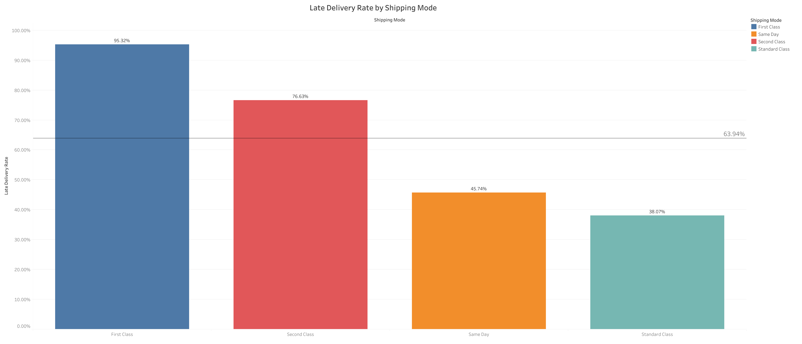

# Supply Chain Shipping Analysis

## Overview

An exploratory analysis of the DataCo Smart Supply Chain dataset, using SQL for analysis and Tableau for visualization. This project is in process. One business question fully answered so far, with more planned.

## Background

15 years of experience in fulfillment, inventory, and operations gave me a habit of noticing when numbers don't add up and digging into why. This project applies that instinct to a public retail supply chain dataset, using it to build and demonstrate SQL and Tableau skills.

## Dataset

[DataCo Smart Supply Chain for Big Data Analysis](https://www.kaggle.com/datasets/shashwatwork/dataco-smart-supply-chain-for-big-data-analysis)
~ 180,000 rows covering orders, shipping modes, delivery status, product categories, and customer/order details. Sourced from Kaggle.

## Question 1: Which shipping mode has the highest late-delivery rate?

**Why this question?:**
Shipping mode reliability directly affects customer trust/satisfaction along with operational cost. I wanted to see whether faster, more expensive shipping options actually deliver on their promise.

```sql
-- Main question: late delivery rate shipping mode
SELECT "Shipping Mode",
       AVG("Late_delivery_risk" * 100) as avg_late_delivery
FROM orders
GROUP BY "Shipping Mode"
ORDER BY avg_late_delivery DESC;
```

**Finding:**
First Class orders were late 95.3% of the time. This is by far the highest of any shipping mode. Second Class followed at 76.6%. Same Day was late 45.7% of the time, and Standard Class had the lowest rate at 38.1%.



**Interpretation:**
Based on my own operations background, I suspected this was tied to delivery promise windows rather than handling quality. Faster shipping modes are usually held to stricter, tighter delivery windows, making the same real-world delays more likely to register as "late". I tested this by comparing scheduled vs. real shipping days:

| Shipping Mode  | Scheduled (days) | Real (days) |
| -------------- | ---------------- | ----------- |
| First Class    | 1                | 2           |
| Second Class   | 2                | ~4          |
| Same Day       | 0                | ~0.5        |
| Standard Class | 4                | ~4          |

This supported the hypothesis, but also surfaced something more specific: Second Class's actual shipping time (3.99 days) is nearly identical to Standard Class's (3.996 days), despite Second Class promising a much shorter window. This suggests Second Class orders may not be receiving meaningfully different handling than Standard Class. They are simply held to a faster promise on what looks like the same process.

**Follow-up Finding (Resolved):**
I investigated the date fields directly to understand why the day-count comparison didn't perfectly explain the late-delivery flag. Looking at individual rows, order date and shipping date were exactly the same number of days apart, even down to the time of day. This pattern held across every shipping mode that I checked, which strongly suggests these date fields are generated by a fixed formula (order date plus a set offset per mode) rather than reflecting genuine, variable real-world shipping events.

Since the dates don't appear to be real measurements, I checked whether Late_delivery_risk was actually derived from Delivery Status instead. Grouping the full dataset by both columns together confirmed this. Every row with Delivery Status = "Late delivery" has Late_delivery_risk = 1, and every other status has 0, with no exceptions across all ~180,000 rows. These two fields are a direct 1:1 match.

```sql
-- Follow-up: checked whether Late_delivery_risk is actually derived from Delivery Status instead of date/day-count fields
SELECT "Delivery Status",
       "Late_delivery_risk",
       COUNT(*) as total_rows
FROM orders
GROUP BY "Delivery Status",
         "Late_delivery_risk";
-- Result: perfect 1:1 match across all ~180,000 rows
-- Every "Late delivery" status row has risk=1, every other status has risk=0
-- Confirms Late_delivery_risk comes from Delivery Status
```

This also explains the earlier 26,513 vs 1,301 discrepancy among First Class orders with identical day counts. The 1,301 "not late" rows all had a Delivery Status of "Shipping canceled." Cancelled orders never actually ship, so they are excluded from the late-delivery flag regardless of what the (synthetic) date fields show.

**Conclusion:**
The shipping dates in this dataset appear to be artificially generated and not real measurements. However, the Late_delivery_risk column remains reliable as it is consistent with the Delivery Status column. The original finding of First Class having a 95.3% late rate still holds.

**Dashboard:** [View on Tableau Public](https://public.tableau.com/app/profile/sean.barile/viz/SupplyChainShippingModeAnalysis/Sheet1)

## What's next?

- A second question examining product category and profit margins.
- Investigating whether the Second Class/Standard Class similarity holds across other metrics, not just shipping days.

## Files

- `analysis.sql` -- All queries used, including data-quality checks, in the order they were run.
- `decisions_log.md` -- Reasoning behind key choices and findings along the way.
